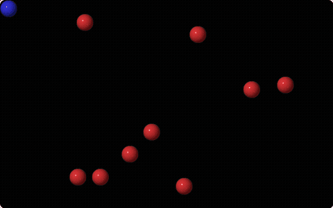
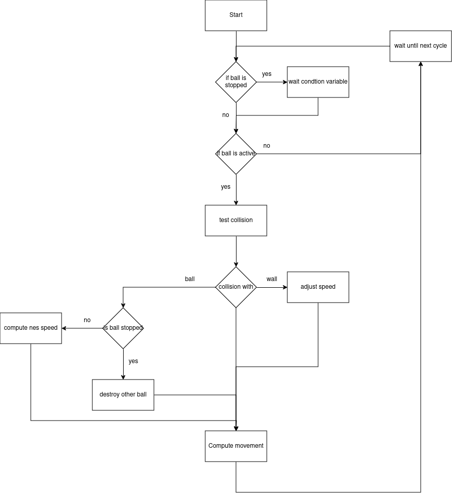

# Concurrent Billiards

A billiards simulation in C where **every ball is its own POSIX thread**, synchronised with mutexes and a condition variable, rendered with SDL2.

<p align="center"></p>

> hepia (HES-SO Geneva) · Concurrent Programming · 2024
> Team project: **Adrian Spycher** & Jad Tayan

## How it works

The program runs **12 threads**: one per ball (10), one for the keyboard and one for the display.

- **Balls** – each ball thread updates its own position every 7 ms, bounces on the walls, detects collisions with the other balls and computes the elastic collision response. Balls slow down over time and stop below a minimum speed.
- **Player** – the blue ball is pushed with the arrow keys.
- **Destruction** – a moving ball that hits a stopped ball destroys it (explosion animation and sound).
- **Display** – a dedicated thread redraws the scene at a fixed frame rate with SDL2 (graphics and sound).

### Synchronisation

| Primitive | Usage |
|---|---|
| One **mutex per ball** | protects the ball's speed; a collision locks each ball in turn, never both at once, so no deadlock can occur |
| **Condition variable** | stopped or destroyed balls wait passively instead of busy-looping; a broadcast wakes them up to exit cleanly |
| Error-checking mutexes | every return value of the pthread / OS primitives is checked |

<p align="center"></p>

## Build & run

Requirements: Linux, `gcc`, `make`, SDL2, SDL2_image and SDL2_mixer.

```bash
# Debian / Ubuntu
sudo apt install build-essential libsdl2-dev libsdl2-image-dev libsdl2-mixer-dev
# Arch
sudo pacman -S base-devel sdl2 sdl2_image sdl2_mixer

make run
```

| Key | Action |
|---|---|
| Arrow keys | push the blue ball |
| Esc | quit |

## Project structure

```
├── billard.c / .h            ball threads, collision response, main
├── keyboard.c / .h           keyboard thread
├── display_and_sound.c / .h  display thread, SDL2 rendering and sound
├── tools.c / .h              collision detection and helpers
├── images/, sounds/          sprites and sound effects
└── docs/                     demo and flowchart
```

## Credits

The starter template, the image and sound assets (`images/`, `sounds/`) and the precompiled `libcalc_collision_speeds.a` were provided by the course; the collision response used in the simulation is our own implementation (`my_calc_collision_speeds` in `billard.c`).

## License

[MIT](LICENSE), except for the files provided by the course mentioned above.
